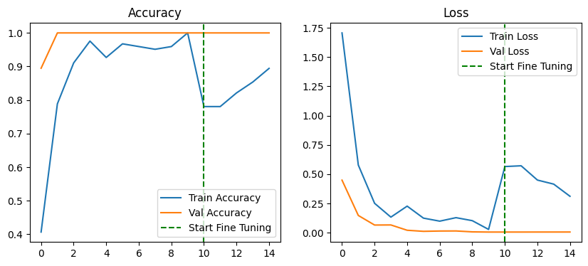
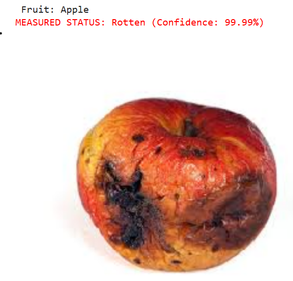
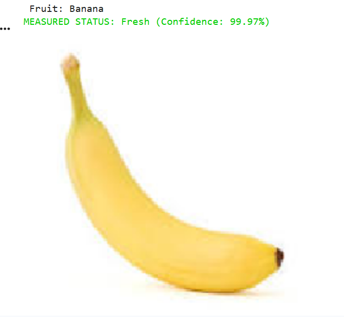
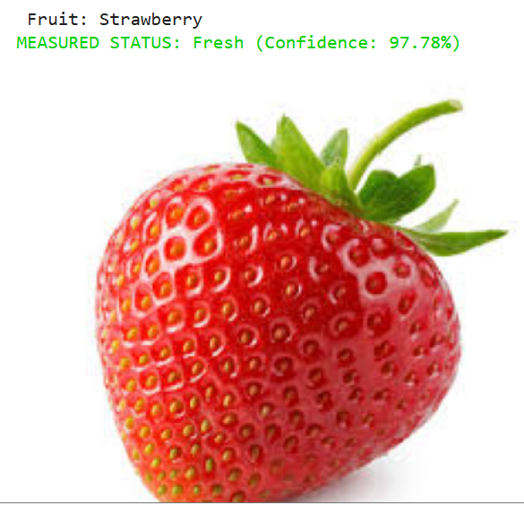
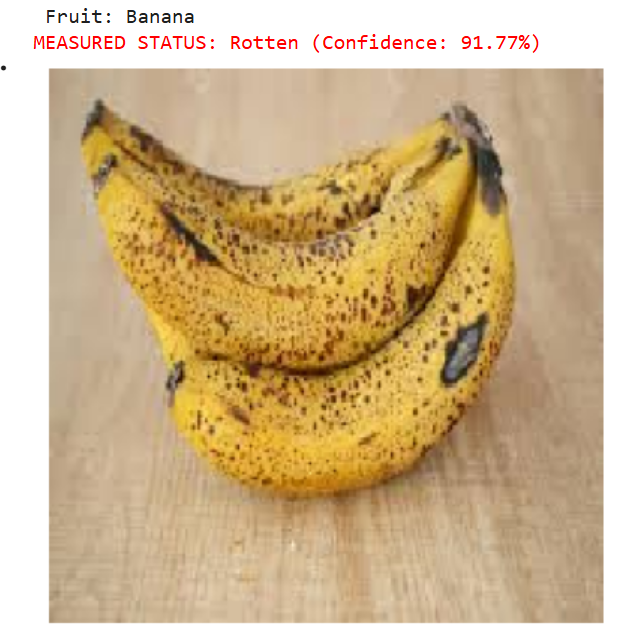

# Fruit Freshness Detection

[](https://colab.research.google.com/github/AbdulRafey05/fruit-freshness-detection/blob/main/FRUIT_CLASSIFICATION.ipynb)


A computer vision project that looks at a photo of an **apple, banana or strawberry** and tells whether it is **fresh or rotten**. It uses transfer learning with MobileNetV2 and includes a Gradio web app for single and batch image scanning.

## Classes

The model predicts 6 classes:

`Apple_Fresh` · `Apple_Rotten` · `Banana_Fresh` · `Banana_Rotten` · `Strawberry_Fresh` · `Strawberry_Rotten`

## Dataset

- **566 images** were collected from online sources and labelled by fruit and freshness (see [data/README.md](data/README.md) for the folder layout and per-class counts).
- The classes were unequal (from 33 to 220 images), so every class was trimmed to the smallest class size, **33 images per class**, giving 198 images.
- The balanced data was split 70% / 15% / 15% (train / validation / test) with a fixed seed (1337).
- The Keras data generators loaded **123 training, 19 validation and 34 test images**.
- The dataset itself is not included in this repository because of its size.

## Pipeline

1. Upload and extract the dataset zip
2. Restructure the folders into 6 classes
3. Balance the classes (33 images each)
4. Split into train / validation / test
5. Data generators with augmentation (rotation, shifts, zoom, horizontal flip, brightness, shear)
6. Build the model (MobileNetV2 + new classification head)
7. Phase 1 training with the base model frozen
8. Phase 2 fine-tuning of the top 40 layers
9. Evaluation on the test set and training curves
10. Prediction on new images
11. Gradio web app

## Model

- **Base:** MobileNetV2 pre-trained on ImageNet, input size 224 × 224
- **Head:** Global Average Pooling → Dense (256, ReLU) → Dropout (0.4) → Dense (6, softmax)
- **Phase 1:** base frozen, 10 epochs, Adam with learning rate 0.001
- **Phase 2:** top 40 base layers unfrozen, up to 10 epochs, Adam with learning rate 0.00001, with `ReduceLROnPlateau` and `EarlyStopping` on validation loss

## Results

| Metric | Value |
|---|---|
| Test accuracy | **88.24%** (34 test images) |
| Validation accuracy | 100% (19 validation images) |



### Prediction examples

Sample images run through the trained model. The confidence shown is the model's own output score, not a measure of accuracy.

| Apple – Rotten | Banana – Fresh |
|:---:|:---:|
|  |  |
| **99.99%** confidence | **99.97%** confidence |

| Strawberry – Fresh | Banana – Rotten |
|:---:|:---:|
|  |  |
| **97.78%** confidence | **91.77%** confidence |

> **Please read the numbers carefully.** The test set has only 34 images and the validation set only 19, so these results are a rough indication and not a reliable measure of real-world accuracy. The 100% validation accuracy is probably a sign of the very small validation set. In the training curves, training accuracy dropped when fine-tuning started and then rose again, so fine-tuning was not shown to improve the results on this small dataset.

## Web app (Gradio)

The last notebook cell launches a Gradio app with two tabs:

- **Single Scan:** upload, paste or capture an image with the webcam, then get a fresh/rotten verdict card with the confidence score.
- **Batch Scan:** upload many images at once and get a gallery with a fresh/rotten caption and confidence for each image.

## How to run

The notebook is written for **Google Colab**.

1. Click the **Open in Colab** badge above.
2. Run the cells in order. When asked, upload your own `Fruit_dataset.zip` (layout in [data/README.md](data/README.md)).
3. Training runs on the dataset, evaluates on the test set and saves the model as `MultiFruit_Freshness_Model_Balanced.h5`.
4. Run the last cell to start the Gradio app and open the link it prints.

To run locally instead, install the requirements and remove the Colab-only upload cells (`from google.colab import files` and `files.upload()`):

```bash
pip install -r requirements.txt
```

## Limitations and future work

- Very small dataset (198 images after balancing) collected from online sources
- Tiny validation and test sets, so the accuracy numbers are not very reliable
- Only 3 fruits and 2 states (fresh or rotten); there is no "partly ripe" or "unknown" class
- Improvement ideas: collect more images, keep more of the larger classes using class weights, evaluate with cross-validation, and test on photos taken in real conditions

## Tech stack

Python · TensorFlow / Keras · MobileNetV2 · NumPy · Matplotlib · split-folders · Gradio

## Author

**Muhammad Abdul Rafey Yashir**
Artificial Intelligence, Sindh Madressatul Islam University
[LinkedIn](https://www.linkedin.com/in/abdulrafeyyashir) · [Portfolio](https://abdulrafey05.github.io/Portfolio/)

## License

Released under the [MIT License](LICENSE).
